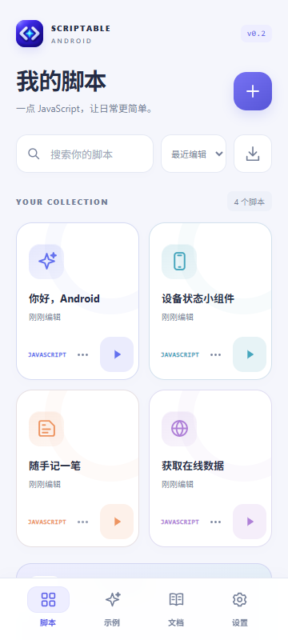
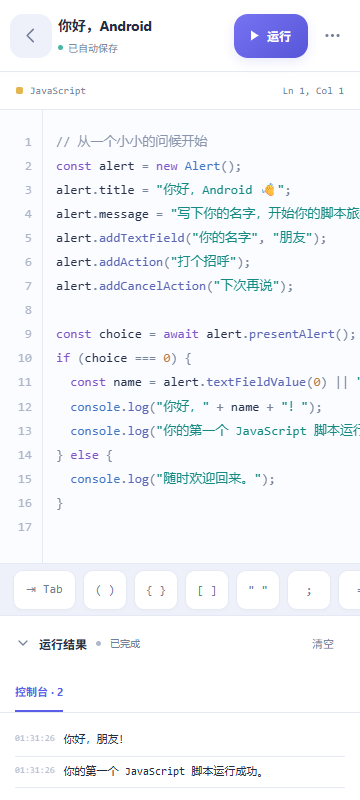
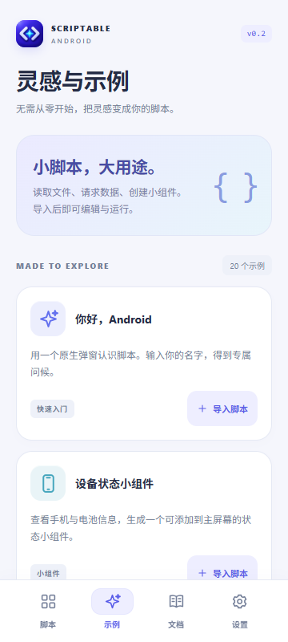
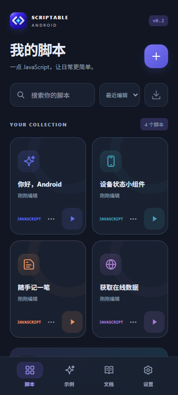

<p align="center">
  
</p>

<h1 align="center">Scriptable Android</h1>

<p align="center">在 Android 上，用 JavaScript 把灵感变成脚本、工具和桌面组件。</p>
<p align="center"><em>An independent JavaScript automation app for Android, inspired by Scriptable.</em></p>

<p align="center">
  <a href="https://github.com/EdenleeGitHub/scriptable-android/releases/latest"></a>
  
  <a href="LICENSE"></a>
</p>

这是一个参照 [Scriptable 公开文档](https://docs.scriptable.app/) 从头实现的独立安卓替代项目：保留熟悉的 JavaScript API 和脚本工作流，把文件、通知、系统交互和桌面组件接到 Android。界面包含脚本库、编辑器、示例库和离线文档，适合从一个小脚本开始，也适合迁移已有的自动化工具。

本项目与 Scriptable 及 Apple 没有隶属或合作关系，未使用原版源码或 Apple 的图标、字体、音频素材。平台能力与兼容差异在下文和 [兼容说明](docs/compatibility.md) 中明确列出。

## 界面预览

下面是当前界面的**浏览器预览**，用于展示布局与交互；安卓系统弹窗、权限及启动器组件需要安装 APK 使用。

<table>
  <tr>
    <td align="center"><strong>脚本库</strong><br /></td>
    <td align="center"><strong>脚本编辑器</strong><br /></td>
  </tr>
  <tr>
    <td align="center"><strong>示例库</strong><br /></td>
    <td align="center"><strong>深色主题</strong><br /></td>
  </tr>
</table>

## 可以做什么

| 能力 | 当前实现 |
| --- | --- |
| 写脚本、立即运行 | 自动保存、语法高亮、行号、补全、快捷输入、顶层 `await`、运行日志与停止；独立 Worker 执行脚本 |
| 管理自己的工具箱 | 脚本搜索、排序、复制、重命名、导入和导出；20 个内置示例与 60 组 API 离线文档 |
| 获取和保存数据 | HTTP/HTTPS、JSON、图片、二进制、multipart、cookies；本地文件、模块导入、Base64 与加密 Keychain |
| 创建交互工具 | 原生 `Alert` 和文本框、可交互 `UITable`、隔离 `WebView`、HTML 预览、系统分享与跨应用链接 |
| 连接 Android | 按需申请定位、日历、联系人、照片等权限；剪贴板、文件选择、朗读、听写、通知、提醒事项及邮件/SMS 编辑器 |
| 绘制和展示 | Canvas、路径、颜色、渐变、图片转换、字体、日期和 XML；桌面组件布局、参数、链接及计时器 |
| 使用图标 | 兼容 9,155 个 SF 图标标识，使用原创图形或开放 MDI 字形替代；通用替代可通过 API 查询 |

例如，你可以做随手记、网络查询、剪贴板整理、倒计时组件，或把日历与天气组合成自己的桌面信息卡。

## 安装与第一次运行

1. 打开 [最新 Release](https://github.com/EdenleeGitHub/scriptable-android/releases/latest)，下载 `Scriptable-Android-0.2.1-release.apk`。
2. 在 Android 8.0 及以上的手机上安装，保持 Android System WebView 更新。
3. 打开应用，在示例库选择「随手记」或问候示例，点击运行；也可以新建脚本并粘贴下面的代码。

```javascript
const alert = new Alert();
alert.title = "你好，Android 👋";
alert.message = "这是我的第一个脚本。";
alert.addAction("开始吧");
await alert.presentAlert();
console.log("运行成功！");
```

升级本项目 Release 时直接覆盖安装即可保留数据，覆盖更新需要相同签名。自行构建的 APK 使用自己的签名，不能直接覆盖本项目已签名的安装包。

**0.2.1 修复：**默认文本框的空颜色曾被安卓桥接转成字符串 `"null"`，使问候、随手记等示例报 `Unknown color`。本版修复此问题，并处理通知空链接、空取消按钮、组件空 tint/url 和表格默认颜色，加入相应回归测试。

## 兼容范围

目标是让尽可能多的 Scriptable 脚本在 Android 上运行，并为平台差异提供可用的替代方案。当前不是 iOS 的完全等价实现；需要系统服务的脚本应结合 [兼容说明](docs/compatibility.md) 调整。

| 原平台能力 | Android 方案与限制 |
| --- | --- |
| Siri / 快捷指令 | 桌面脚本快捷方式、URI 和 x-callback，可供 Tasker/MacroDroid 等调用 |
| iCloud 文件 | `FileManager.iCloud()` 使用用户授权的 SAF 或已同步文件夹，不连接 Apple iCloud 账户 |
| WidgetKit / 锁屏组件 | 安卓桌面组件；后台刷新受系统调度和电池策略影响，锁屏家族使用桌面替代 |
| SF Symbols | 原创或开放字形映射；2,051 个标识使用已标记的通用替代，未知标识返回 `null` |
| 提醒事项 | 应用内持久任务库与通知调度，不等同于 Apple/Google 提醒账户同步 |
| 邮件、短信、相机、听写 | 调用手机提供的系统应用或服务，可用性取决于设备；外部编辑器无法报告实际发送结果 |

运行器也有明确的内存、文件、网络响应和执行时间上限。完整边界、数据模型和资源限制见 [兼容说明](docs/compatibility.md)、[系统契约](docs/system-contract.md) 与 [呈现契约](docs/presentation-contract.md)。

## 开发与测试

原生层采用 Java，编辑器和运行器位于 WebView；脚本在独立 Worker 中运行。浏览器预览可以开发界面和运行普通脚本，Android 权限、系统数据提供器和桌面组件需要 APK。

开发环境：JDK 17、Android SDK 36 / Build Tools 35.0.0、Node.js 22+、Python 3；项目包含 Gradle Wrapper。设置 `JAVA_HOME` 和 `ANDROID_HOME`，或在本机 `local.properties` 中配置 `sdk.dir`。首次构建需下载 Gradle 和测试依赖。

```bash
git clone https://github.com/EdenleeGitHub/scriptable-android.git
cd scriptable-android
npm ci
npm test
npx playwright install chromium
npm run test:ui
node tools/check-api-surface.cjs
```

启动浏览器预览：

```bash
npm run preview
# 打开 http://127.0.0.1:4173/
```

构建并测试安卓调试包：

```bash
./gradlew testDebugUnitTest assembleDebug lint
# APK: app/build/outputs/apk/debug/app-debug.apk
```

Windows 可使用 `gradlew.bat`，或执行包含测试、lint 和 APK 导出的脚本：

```powershell
pwsh -File tools/build-android.ps1 -Debug
```

Release 构建需要自己的持久签名配置；签名、密钥和本机 SDK 路径不应提交到仓库。

当前验证范围：

- **122 项 Worker 自动化测试**，其中 25 项执行全部 20 个内置示例并检查取消、权限拒绝和存储失败等路径。系统提供方使用合成数据。
- **10 项 Robolectric 安卓框架回归**，覆盖实际 `JSONObject`、颜色解析、弹窗视图、通知等路径。
- **浏览器集成与布局检查**，覆盖编辑器、移动窄屏、深色主题、HTTP/multipart/重定向、PNG 分段处理及跨加载回调。
- **731 个公开成员入口检查**，结果见 [API 入口报告](docs/api-surface-report.json)。入口存在性不代表每项行为已经完整验证。

0.2.1 已完成 Java 编译、lint、APK 构建和包内资源核对，尚未完成手机真机复测。Robolectric 与浏览器测试不能替代设备上的权限、启动器、后台调度和系统栏验收。

主要目录：

```text
app/src/main/java/       Android 系统桥接、组件、通知与存储
app/src/main/assets/     界面、脚本运行器、示例与离线文档
app/src/test/            安卓框架回归测试
tests/                  Worker 与浏览器测试
tools/                  预览、构建和 API 检查工具
docs/                   兼容契约、设计说明与界面截图
```

## 参与改进

欢迎提交 Issue 和 Pull Request，尤其是脚本兼容问题、真机反馈、示例和界面适配。报告错误时请附上应用版本、Android/WebView 版本、复现步骤、最小脚本及完整错误信息；涉及系统能力时说明设备型号与权限状态。

提交前的环境与检查步骤见 [贡献指南](CONTRIBUTING.md)，版本变化见 [更新记录](CHANGELOG.md)。复现首页截图可运行 `node tools/capture-screenshots.cjs`。

修改运行器或原生桥接后，请运行相关测试，并为修复补充能复现问题的回归用例。新增 API 时同步维护应用内文档、兼容说明和公开入口报告。

## 许可证与致谢

项目原创源码采用 [MIT License](LICENSE)。第三方字体、图标和元数据保留各自许可证，详见 [第三方声明](THIRD_PARTY_NOTICES.md) 与资源目录中的许可文件。

感谢 [Scriptable](https://scriptable.app/) 的公开 API 文档，以及为开放图标和开发工具贡献的维护者。

